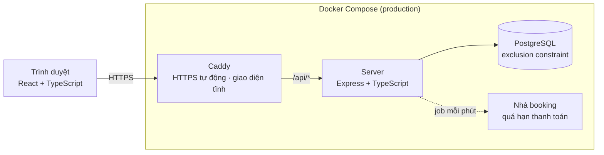
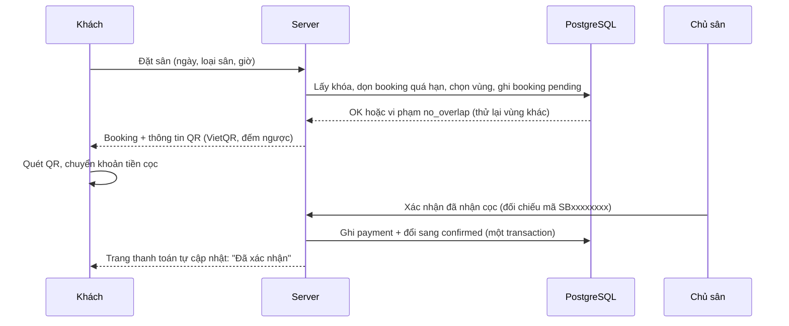

# ⚽ Hệ Thống Đặt Sân Bóng

[](https://github.com/khanhtaii19/FootballApp/actions/workflows/ci.yml)

Ứng dụng web đặt sân bóng đá mini cho một cụm sân (2 sân 7, mỗi sân 7 tách được thành 3 sân 5):
khách xem giờ trống, đặt sân, chuyển khoản tiền cọc bằng mã **VietQR**; chủ sân quản lý bằng **lịch tổng** và xác nhận cọc.

Dự án tập trung vào các bài toán thật của một hệ thống đặt chỗ: **không bao giờ đặt trùng** kể cả khi nhiều người bấm cùng lúc,
giữ chỗ tạm có hạn, tiền cọc và hoàn cọc, và triển khai an toàn lên máy chủ thật.

> 🔗 **Demo:** chưa deploy. Hướng dẫn triển khai từng bước tại [docs/DEPLOY.md](docs/DEPLOY.md).

## ✨ Điểm nhấn kỹ thuật

**1. Mô hình "6 vùng" biến bài toán sân ghép thành một quy tắc duy nhất.**
Mỗi mặt cỏ chia 3 vùng; sân 5 chiếm 1 vùng, sân 7 chiếm cả 3. Hai booking xung đột khi **dùng chung ít nhất một vùng và thời gian chồng nhau**.
Không có chuỗi `if/else` cho từng tổ hợp sân 5/sân 7.

```
Sân 7 số 1:  [ A1 | A2 | A3 ]
Sân 7 số 2:  [ B1 | B2 | B3 ]
```

**2. Chống trùng lịch ở tầng database, không chỉ trong code.**
Kiểm tra "còn trống thì thêm" bằng code có race condition: hai request cùng thấy trống rồi cùng thêm.
Giải pháp: *exclusion constraint* của PostgreSQL (`EXCLUDE USING gist (zone_id WITH =, tstzrange(starts_at, ends_at) WITH &&)`) làm chốt chặn cuối;
tạo booking còn lấy một *advisory lock* để các giao dịch xếp hàng thay vì tranh nhau khóa. Prisma không hỗ trợ constraint này nên nó nằm trong migration SQL thuần.

**3. Một lỗi đồng thời có thật đã được tìm ra và chứng minh bằng số liệu.**
Khi nhiều request cùng chọn một vùng rảnh, chỉ một request thắng constraint, số còn lại bị từ chối oan dù vùng khác vẫn trống.
Mô phỏng trên PostgreSQL thật: 8 request sân 5 cùng giờ chỉ thành công **3/8** với logic ban đầu và **6/8** (đúng bằng số vùng) sau khi thử lại với vùng khác.
Test đồng thời chạy trong CI.

**4. Giữ chỗ tạm không bao giờ "chết" chặn người khác.**
Booking `pending` có hạn thanh toán. Job nền nhả chỗ mỗi phút, và việc dọn cũng chạy ngay khi có người đặt hoặc xem giờ trống,
nên khoảng trễ của job không làm khách mất giờ. Xác nhận cọc là một câu lệnh nguyên tử, từ chối booking đã quá hạn.

**5. Thanh toán QR tự viết, đối chiếu độc lập.**
Chuỗi VietQR (EMVCo/NAPAS) được tạo trong [`server/src/lib/vietqr.ts`](server/src/lib/vietqr.ts) kèm CRC-16/CCITT;
đã kiểm tra khớp giá trị chuẩn và khớp một cài đặt CRC độc lập bằng Python. Giao diện vẽ QR kèm đồng hồ đếm ngược và **tự cập nhật** khi chủ sân xác nhận.
Tiền cọc, chính sách hoàn cọc (hủy trước X giờ, chủ sân hủy thì luôn hoàn) được lưu và kiểm thử.

**6. Sẵn sàng cho production, kiểm tra bằng CI thật.**
Server **từ chối khởi động** nếu cấu hình production thiếu hoặc yếu (secret mẫu, trùng nhau, quá ngắn...); không có tài khoản demo công khai ở production.
Docker image chạy bằng user thường; Caddy tự cấp HTTPS và đặt header bảo mật. CI dựng nguyên stack production rồi chạy smoke test từ bên ngoài
(đăng nhập, đặt sân, mã QR, sao lưu rồi khôi phục).

## 🏗 Kiến trúc



Luồng đặt sân:



## 🚀 Chạy trên máy (dev)

Cần Docker và Node.js 22.

```bash
# 1. Database + server (tự chạy migration và nạp dữ liệu mẫu)
docker compose up -d

# 2. Giao diện
cd client
npm install
npm run dev
```

- Giao diện: http://localhost:5173 · API: http://localhost:3000/api · Health: http://localhost:3000/api/health
- Tài khoản demo (chỉ ở môi trường dev): chủ sân `owner@sanbong.vn` / `OwnerPass123`. Khách tự đăng ký trên giao diện.

Chạy server không qua Docker:

```bash
docker compose up db -d
cd server
cp .env.example .env          # DATABASE_URL trỏ tới cổng 5433 của compose
npm install
npx prisma migrate dev
npm run db:seed
npm run dev
```

## 🧪 Kiểm thử

```bash
# Server: unit test không cần database; integration test cần PostgreSQL (DATABASE_URL tới DB có chữ "test")
cd server
cp .env.test.example .env.test    # và tạo database sanbong_test
npm test

# Client: lint, build (kiểm tra kiểu) và test
cd client
npm run lint && npm run build && npm test
```

Test tự từ chối chạy trên database không có chữ "test" (vì chúng xóa dữ liệu).
CI ([`.github/workflows/ci.yml`](.github/workflows/ci.yml)) chạy: lint và kiểm tra kiểu, test server với PostgreSQL thật (gồm kiểm thử đồng thời),
test client, và job **Production stack** dựng nguyên stack Docker để chạy [`deploy/smoke-test.sh`](deploy/smoke-test.sh).

## 🌐 Triển khai

Hướng dẫn đầy đủ (VPS, tên miền, HTTPS, sao lưu, khôi phục, đổi mật khẩu chủ sân, giám sát): **[docs/DEPLOY.md](docs/DEPLOY.md)**.

```bash
cp deploy/.env.production.example .env    # điền domain, mật khẩu, khóa bí mật
docker compose -f docker-compose.prod.yml up -d --build
```

## 📁 Cấu trúc dự án

```
├── client/                  # React + TypeScript (Vite)
│   └── src/
│       ├── pages/           # Trang của khách; pages/owner/ là trang chủ sân
│       ├── components/      # Layout, PaymentQr (QR + đếm ngược), OwnerActions...
│       └── lib/             # api (tự làm mới token), format, schedule, countdown...
├── server/                  # Express + TypeScript
│   ├── prisma/              # schema, migrations (gồm exclusion constraint)
│   └── src/
│       ├── routes/          # auth, bookings, blocks, settings, zones, health
│       ├── services/        # nghiệp vụ: đặt sân, hết hạn, thanh toán, block
│       ├── lib/             # env (fail-fast), vietqr, payment, time-utils, db-locks
│       ├── middleware/      # auth, validate, rate-limit, request-logger
│       ├── jobs/            # nhả booking quá hạn
│       ├── scripts/         # seed, đặt lại mật khẩu chủ sân (chạy được trong image production)
│       └── tests/
├── deploy/                  # Caddyfile, web.Dockerfile, backup/restore/smoke-test, .env mẫu
├── docs/                    # DEPLOY.md, kế hoạch dự án
├── docker-compose.yml       # dev: database + server
└── docker-compose.prod.yml  # production: database + server + Caddy
```

## 🔌 API (tóm tắt)

| Method | Endpoint | Quyền | Mô tả |
|---|---|---|---|
| POST | `/api/auth/register` · `/login` · `/refresh` | Công khai | Tài khoản (đăng nhập sai quá 10 lần/15 phút bị khóa tạm theo IP) |
| GET | `/api/settings` · `/api/zones` | Công khai | Cấu hình, 6 vùng sân |
| PUT | `/api/settings` | Owner | Giá, giờ, cọc, chính sách hủy, tài khoản ngân hàng |
| GET | `/api/bookings/available` | Công khai | Giờ trống theo ngày, loại sân, thời lượng |
| POST | `/api/bookings` | Đăng nhập | Đặt sân (giữ chỗ tạm) |
| GET | `/api/bookings?date=YYYY-MM-DD` | Đăng nhập | Danh sách (chủ sân thấy tất cả, khách thấy của mình) |
| GET | `/api/bookings/:id/payment` | Chủ booking / Owner | Tiền cọc, nội dung chuyển khoản, chuỗi QR VietQR |
| PATCH | `/api/bookings/:id/confirm` | Owner | Xác nhận đã nhận cọc |
| PATCH | `/api/bookings/:id/cancel` | Chủ booking / Owner | Hủy, trả kết quả hoàn cọc |
| PATCH | `/api/bookings/:id/refund` | Owner | Ghi nhận đã hoàn cọc |
| GET/POST/DELETE | `/api/blocks` | Owner | Khóa vùng (bảo trì) |
| GET | `/api/health` | Công khai | Tình trạng server và database |

## 🖥 Giao diện

| Đường dẫn | Ai dùng | Chức năng |
|---|---|---|
| `/book` | Mọi người | Chọn ngày, loại sân, thời lượng, giờ trống; xem giá và tiền cọc |
| `/bookings/:id/pay` | Khách | QR chuyển khoản, đếm ngược giữ chỗ, tự cập nhật khi chủ sân xác nhận |
| `/my-bookings` | Khách | Lịch sắp tới/lịch sử, hủy và xem kết quả hoàn cọc |
| `/owner` | Chủ sân | **Lịch tổng** lưới 6 vùng theo ngày, thống kê, khóa sân |
| `/owner/bookings` | Chủ sân | Chờ xác nhận, cần hoàn cọc, tìm theo mã chuyển khoản/tên/SĐT |
| `/owner/settings` | Chủ sân | Giá, giờ, cọc, chính sách hủy, tài khoản ngân hàng |

## ⚠️ Giới hạn đã biết

- Xác nhận đã nhận cọc do chủ sân bấm tay. Tự động hóa cần PayOS/VietQR kèm webhook (xử lý idempotency).
- Chưa có email thông báo và đặt cố định hàng tuần.
- Token lưu ở `localStorage` (rủi ro XSS); hướng nâng cấp là refresh token trong cookie `httpOnly`.
- Chạy một instance server; bộ giới hạn đăng nhập dùng bộ nhớ (nhiều instance cần Redis).

## 📦 Công nghệ

| Lớp | Công nghệ |
|---|---|
| Giao diện | React 19, TypeScript, Vite, React Router, TanStack Query |
| Backend | Node.js 22, Express, TypeScript, Zod |
| Database | PostgreSQL 16, Prisma (kèm migration SQL cho exclusion constraint) |
| Xác thực | JWT (access + refresh, tự làm mới ở client), bcrypt |
| Kiểm thử | Vitest, Testing Library, integration test trên PostgreSQL thật |
| Hạ tầng | Docker, Docker Compose, Caddy (HTTPS tự động), GitHub Actions |

## 📋 Kế hoạch phát triển

- [x] Phần 1: Nền tảng (repo, Docker, Prisma, CI)
- [x] Phần 2: Tài khoản và phân quyền
- [x] Phần 3: Quản lý sân, giá, cấu hình
- [x] Phần 4: Lõi đặt sân và chống trùng ⭐
- [x] Phần 5: Giữ chỗ tạm, đặt cọc, QR VietQR, hoàn cọc
- [x] Phần 6: Giao diện React (khách và chủ sân)
- [ ] Phần 7: Đặt cố định hàng tuần, email thông báo
- [x] Phần 8: Sẵn sàng production (Docker, HTTPS, sao lưu, smoke test trong CI); còn việc: deploy thật và tìm người dùng thật
